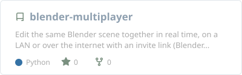
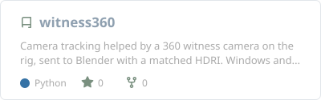
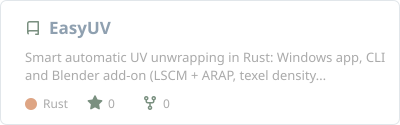
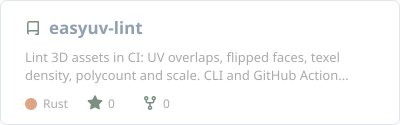
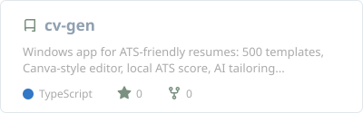
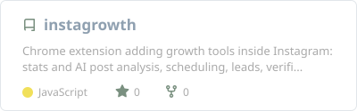
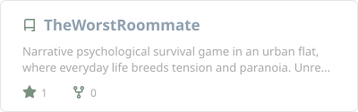
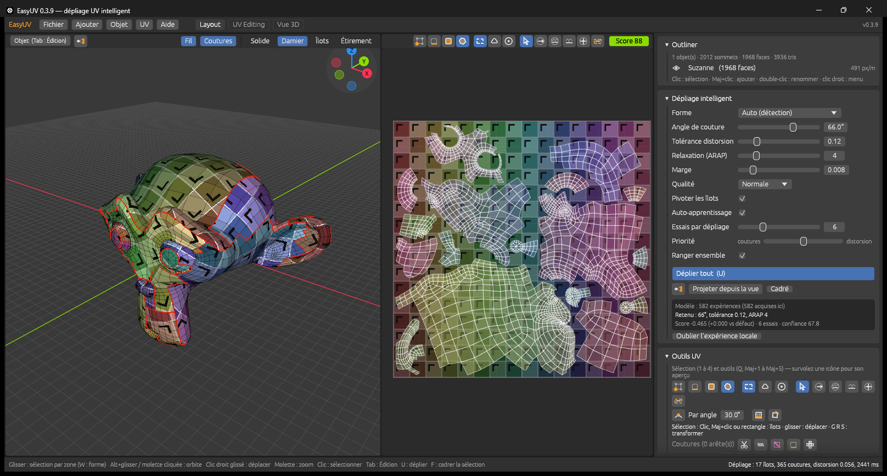
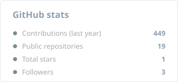
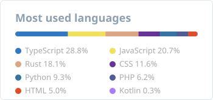

<!-- Header -->

---

## About

Precision over decoration. I work at the intersection of technical rigor and cinematic sensibility: building desktop tools and web systems, crafting 3D assets, and designing experiences with deliberate restraint.

- Studying Computer Science at **YNOV Lyon**
- New: **[Blender Multiplayer](https://github.com/lburdier/blender-multiplayer)**, a Blender add-on to edit the same scene together in real time, on a LAN or over the internet with a private invite link
- New: **[witness360](https://github.com/lburdier/witness360-releases)**, a Windows and Mac app that tracks a shot with the help of a 360 camera mounted on the rig, then sends the camera and a matched HDRI to Blender
- Building **[EasyUV](https://github.com/lburdier/EasyUV)**, an open-source automatic UV unwrapper in Rust, with a Blender add-on
- Shipping **[easyuv-lint](https://github.com/lburdier/easyuv-lint)**: a CLI and GitHub Action that catches broken 3D assets (UV overlaps, texel density, polycount, scale) on every pull request
- Developing **[The Worst Roommate](https://github.com/lburdier/TheWorstRoommate)**, a PS1-style psychological horror game
- Shipping Windows apps with automatic updates: CV GEN, Umbra Editor, Claude Bridge

> **Let's build something together.** EasyUV welcomes contributors of every level: Rust, Python (Blender add-on), geometry, UI, docs and translations. Pick an issue, open a PR, or just say hi on [LinkedIn](https://www.linkedin.com/in/lucasburdier/).

---

## Latest projects

### Blender Multiplayer

**Several people, one Blender scene, live.** The host shares a private link, guests click it and land in the same scene, on the same network or across the internet (built-in relay, no port forwarding). Every change syncs as it happens: objects, meshes, materials, textures (even while painting), lights, animation. Each player sees who selects what, undo is shared, and the history, chat, autosaves and backups keep the project safe. Render settings stay personal to each PC. Blender 4.2+ and 5.x, pure Python, automatic updates through a Blender extension repository.

<table>
  <tr>
    <td width="50%" align="center"> <b>Host</b>: invite link, internet and LAN addresses, players, history, chat</td>
    <td width="50%" align="center"> <b>Guest</b>: joined over the internet, the host's selection shown in red</td>
  </tr>
</table>

### witness360

**Camera tracking helped by a 360 "witness" camera.** A 360 camera screwed onto the camera rig sees everything around the shot and records its gyroscope. witness360 syncs it to the shot by sound, tracks the plate, solves the camera with the 360 rotation, measures the real field of view on the 360 image, builds an HDRI matched to the plate's colour and exposure, then exports everything to Blender (Alembic .abc and a ready .blend). Insta360 .insv, any camera, S-Log3 / V-Log / LogC and more. Windows and macOS.

  
   <b>Solver</b>: 1803 3D points, 296 frames solved with the 360 gyroscope, error per tracker on the plate

<table>
  <tr>
    <td width="50%" align="center"> <b>Sync</b>: the shot found in a 10 min 360 clip by sound, to the half millisecond</td>
    <td width="50%" align="center"> <b>HDRI</b>: 4096 x 2048 EXR from the 360, colour matched to the plate</td>
  </tr>
  <tr>
    <td width="50%" align="center"> <b>Trackers</b>: hundreds of points, forward-backward check</td>
    <td width="50%" align="center"> <b>Export</b>: animated camera, point cloud, plate and HDRI straight into Blender</td>
  </tr>
</table>

---

## Featured projects

**Also shipping**

- **[Umbra Editor](https://github.com/lburdier/Umbra_Engine-releases)**: retro horror game editor for Windows (Direct3D 11).
- **[Claude Bridge](https://github.com/lburdier/claude-bridge-releases)**: multi-account Claude manager for Windows, with a Code workspace, node-based workflows and token stats.

---

## In pictures

  
   <b>EasyUV</b>: Suzanne unwrapped in one key press, 17 islands, UV score 88, checker preview on the model

<table>
  <tr>
    <td width="50%" align="center"> <b>CV GEN</b>: home screen</td>
    <td width="50%" align="center"> <b>CV GEN</b>: live editor with ATS score</td>
  </tr>
  <tr>
    <td width="50%" align="center"> <b>CV GEN</b>: design studio, 500 templates</td>
    <td width="50%" align="center"> <b>InstaGrowth</b>: stats and recent posts (demo data)</td>
  </tr>
  <tr>
    <td width="50%" align="center"> <b>InstaGrowth</b>: native buttons inside Instagram</td>
    <td width="50%" align="center"> <b>InstaGrowth</b>: lead search and mini-CRM</td>
  </tr>
</table>

---

## Stack

**Code**

 

**3D & design**

<b>Disciplines</b>

 

**development**
- Desktop: Rust (egui), Electron, Windows tooling
- Web: HTML, CSS, JavaScript, TypeScript, React, PHP, Java, SQL, PL/pgSQL
- Mobile: Kotlin (Android)
- Scripting: Python
- Backend: Node.js
- Version control: Git / GitHub, GitHub Actions

**3d & visual**
- Modeling: Blender, Maya
- Texturing: Substance Painter / PBR pipeline
- Pipeline: Blender → Substance → DaVinci / ACES · EXR 32-bit output
- VFX & Compositing: After Effects

**design**
- Graphic Design: Photoshop, Figma
- Art Direction: DA systems, identity, motion principles
- Sound Design: cinematic, industrial, minimal

---

## GitHub

<picture>
  <source media="(prefers-color-scheme: dark)" srcset="https://raw.githubusercontent.com/lburdier/lburdier/output/github-snake-dark.svg">
  <source media="(prefers-color-scheme: light)" srcset="https://raw.githubusercontent.com/lburdier/lburdier/output/github-snake.svg">
  
</picture>

